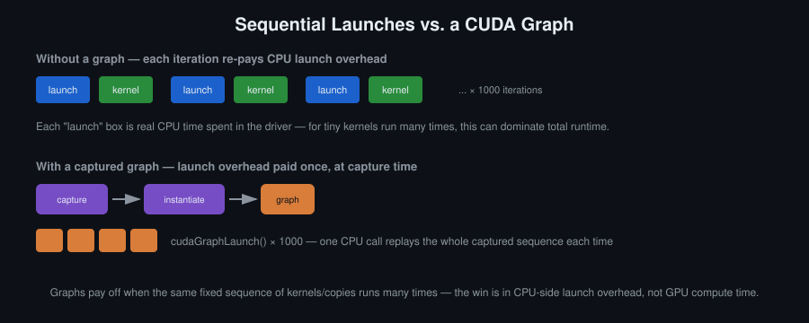

# Day 12: CUDA Graph API

## Objectives
- Capture a sequence of kernel/memory operations into a CUDA graph
- Instantiate and launch a captured graph
- Compare matrix transpose via shared memory vs. via texture binding
- Understand when graph launch overhead pays off vs. regular sequential launches

## Key Concepts
- Graph recording
- Kernel + memory op capture
- Graph launch

## Definitions · Սահմանումներ

*Terms introduced today. Same text as the matching entries in [GLOSSARY.md](../GLOSSARY.md).*

**CUDA graph** — Գործողությունների (kernel-ներ, պատճենումներ, host callback-ներ) և դրանց միջև կախվածությունների գրանցված ուղղորդված ացիկլիկ գրաֆ, որը գործարկվում է որպես մեկ ամբողջություն։

**Graph capture** — Stream-ի գործողությունները կատարելու փոխարեն դրանք գրանցել graph-ում։ Գրանցվում են `cudaStreamBeginCapture`-ի և `cudaStreamEndCapture`-ի միջև ուղարկված գործողությունները։

**Instantiation** — Գրանցված graph-ից գործարկման պատրաստ graph ստեղծել `cudaGraphInstantiate`-ով։ Սա արվում է մեկ անգամ. launch-երի ստուգման և նախապատրաստման ծախսը կատարվում է այստեղ, ոչ թե ամեն գործարկման ժամանակ։

**Launch overhead** — Host-ի կողմից մեկ kernel-ի launch ուղարկելու ծախսը։ Graph-ը նվազեցնում է հենց այս ծախսը, ինչը կարևոր է, երբ կարճ kernel-ների ֆիքսված հաջորդականությունը կատարվում է շատ անգամ։

## Functions · Ֆունկցիաներ

*Interfaces introduced today. Full consolidated list in [API.md](../API.md); concepts in [GLOSSARY.md](../GLOSSARY.md).*

```c
// Graph-ի capture, instantiation և launch
cudaError_t cudaStreamBeginCapture(cudaStream_t stream, enum cudaStreamCaptureMode mode);
cudaError_t cudaStreamEndCapture(cudaStream_t stream, cudaGraph_t *pGraph);
cudaError_t cudaGraphInstantiate(cudaGraphExec_t *pGraphExec, cudaGraph_t graph, unsigned long long flags = 0);
cudaError_t cudaGraphLaunch(cudaGraphExec_t graphExec, cudaStream_t stream);

// Ձայնագրված graph-ի թարմացում՝ առանց նորից instantiate անելու
cudaError_t cudaGraphExecUpdate(cudaGraphExec_t hGraphExec, cudaGraph_t hGraph,
                                cudaGraphExecUpdateResultInfo *resultInfo);

// Ռեսուրսների ազատում
cudaError_t cudaGraphDestroy(cudaGraph_t graph);
cudaError_t cudaGraphExecDestroy(cudaGraphExec_t graphExec);

// Capture-ի ներսում երկրորդ stream-ը ճյուղավորելու և վերադարձնելու համար
// (ինտերֆեյսները՝ Օր 6-ից)
cudaError_t cudaEventRecord(cudaEvent_t event, cudaStream_t stream = 0);
cudaError_t cudaStreamWaitEvent(cudaStream_t stream, cudaEvent_t event, unsigned int flags = 0);

// Սպասում է device-ի ամբողջ աշխատանքի ավարտին։ Capture-ի ներսում արգելված է
cudaError_t cudaDeviceSynchronize(void);
```

## Visual


Graphs don't make the GPU compute faster — they cut the CPU-side overhead of re-issuing the same sequence of launches over and over. The win shows up when you run the same fixed pipeline many times (self-learning task 4 below is designed to make that overhead visible).

The kernel being captured today, `transpose_shared`, is also the textbook worst case for shared-memory bank conflicts: the write walks the tile by row (stride 1, harmless) but the read walks it by column (stride 32, a full 32-way conflict). That's why the template declares `tile[TILE_DIM][TILE_DIM + 1]` rather than the obvious square array. The **Transpose** tab of Day 5's [`bank_conflict_animations.html`](../day05/bank_conflict_animations.html) lets you flip between the write and read phases under all three layouts (plain, padded, swizzled) and watch the transaction count move — worth a minute before writing the kernel, so the `+ 1` isn't just a magic number you copied.

## Resources
https://www.olcf.ornl.gov/wp-content/uploads/2021/10/013_CUDA_Graphs.pdf
https://developer.nvidia.com/blog/cuda-graphs/
https://developer.nvidia.com/blog/efficient-matrix-transpose-cuda-cc/

Manual creation reference:
https://github.com/hummingtree/cuda-graph-with-dynamic-parameters/tree/release

## Code Walkthrough
A small RAII wrapper around a captured CUDA graph:

```c++
struct graph_t
{
    graph_creation_status_t m_status = UNINITIALIZED;
    cudaGraph_t m_graph = nullptr;
    cudaGraphExec_t m_instance = nullptr;

    ~graph_t()
    {
        if (m_graph) {
            cudaGraphDestroy(m_graph);
            m_graph = nullptr;
        }
        if (m_instance) {
            cudaGraphExecDestroy(m_instance);
            m_instance = nullptr;
        }
    }

    inline void launch(cv::cuda::Stream &stream)
    {
        CV_Assert(nullptr != m_instance);
        cudaGraphLaunch(m_instance, cv::cuda::custream(stream));
    }

    inline bool is_created() const { return GRAPH_CRATED == m_status; }
    inline bool is_initiaized() const { return INITIALIZED == m_status; }
    inline bool is_uninitiaized() const { return UNINITIALIZED == m_status; }
    inline void set_initiaized() { m_status = INITIALIZED; }

    static inline void start_capture(cv::cuda::Stream &stream) {
        cudaStreamBeginCapture(cv::cuda::custream(stream), cudaStreamCaptureModeGlobal);
    }

    inline void create_graph(cv::cuda::Stream &stream)
    {
        CV_Assert(nullptr == m_instance);
        CV_Assert(nullptr == m_graph);
        CV_Assert(INITIALIZED == m_status);
        cudaStreamEndCapture(cv::cuda::custream(stream), &m_graph);
        cudaGraphInstantiate(&m_instance, m_graph, 0);   // CUDA 12+ signature
        m_status = GRAPH_CRATED;
    }
};
```

## Hands-On Task · Գործնական առաջադրանք

### Հիմնական առաջադրանք. շարժման հայտնաբերում երկու stream-ով, ձայնագրված graph-ով

Իրական խնդիր, որտեղ graph-ը իրոք շահում է. video-ի ամեն կադրի համար կատարվում է **նույն ֆիքսված pipeline-ը**, և kernel-ները կարճ են, ուստի host-ի launch-ի ծախսը դառնում է նկատելի։

Pipeline-ը մեկ կադրի համար.


Վեց հանգույց, երկու զուգահեռ ճյուղ, մեկ միացման կետ։ Հենց այս DAG-ն է, որ `cudaStreamEndCapture`-ը վերադարձնում է որպես `cudaGraph_t`։

**Քայլերը.**

1. **Երկու stream, երկու վերբեռնում։** `cv::VideoCapture`-ով կարդալ կադրերը։ Ընթացիկ կադրը `cudaMemcpyAsync`-ով ուղարկել stream1-ով, նախորդը՝ stream2-ով։ Host-ի բուֆերները պետք է page-locked լինեն (`cudaHostAlloc` լռելյայն դրոշով), այլապես պատճենումն ասինխրոն չի լինի և ամբողջ վարժությունն իմաստ չի ունենա։
2. **Երկու kernel, զուգահեռ։** `to_gray` kernel-ը գործարկել երկու stream-ում՝ ամեն մեկն իր կադրի վրա։ Այս երկու ճյուղն իրարից անկախ են և պետք է համընկնեն ժամանակի մեջ։
3. **Միացման կետը՝ event-ով։** stream2-ում `cudaEventRecord`, ապա stream1-ում `cudaStreamWaitEvent`։ Սա միակ ճիշտ ձևն է. `cudaDeviceSynchronize`-ը կջնջի ամբողջ իմաստը և, ավելին, capture-ի ներսում արգելված է։
4. **Երկրորդ kernel և ելք։** stream1-ում գործարկել `abs_diff_threshold`-ը՝ երկու մոխրագույն պատկերի մոդուլով տարբերությունը շեմի հետ համեմատելով, ստացված բինար mask-ը `cudaMemcpyAsync`-ով վերադարձնել host։
5. **Ձայնագրել graph-ում։** Ամբողջ վերը նկարագրվածը դնել `cudaStreamBeginCapture(stream1, ...)`-ի և `cudaStreamEndCapture(stream1, &graph)`-ի միջև։ Instantiate անել **մեկ անգամ**, ապա ամեն կադրի համար կանչել միայն `cudaGraphLaunch`։
6. **Չափել։** 1000 կադրի վրա համեմատել մեկ կադրի միջին ժամանակը՝ graph-ով և առանց graph-ի։ Ասել, թե որտեղից է գալիս տարբերությունը և ինչու GPU-ի հաշվարկի ժամանակը չի փոխվել։

**Capture-ի կանոնը, որը սովորաբար բաց է թողնվում։** Capture-ը սկսվում է մեկ՝ *origin* stream-ի վրա (այստեղ՝ stream1)։ stream2-ը capture-ի մեջ ընկնում է **միայն** այն դեպքում, երբ այն event-ով «ճյուղավորվում» է origin stream-ից, և պետք է նույնպես event-ով **վերադառնա** stream1 մինչև `cudaStreamEndCapture`-ը.

```c++
cudaStreamBeginCapture(stream1, cudaStreamCaptureModeGlobal);

cudaEventRecord(fork, stream1);          // stream2-ը միանում է capture-ին
cudaStreamWaitEvent(stream2, fork, 0);

// ... stream1-ի և stream2-ի գործողությունները ...

cudaEventRecord(join, stream2);          // stream2-ը վերադառնում է stream1
cudaStreamWaitEvent(stream1, join, 0);

cudaStreamEndCapture(stream1, &graph);
```

Առանց `fork` event-ի stream2-ի աշխատանքը պարզապես չի ընկնի graph-ի մեջ. առանց `join`-ի `cudaStreamEndCapture`-ը կվերադարձնի սխալ։

**Ինչ է ստուգվում.** մեկ կադրի ելքը համընկնում է `cv::absdiff` + `cv::threshold` հենքի հետ. երկու ճյուղը իրոք համընկնում են ժամանակի մեջ (երևում է, երբ `to_gray`-ն արհեստականորեն երկարացվում է). graph-ով մեկ կադրի ժամանակը փոքր է, և ուսանողը կարող է ասել՝ ինչու։

**Ավելի հեռու գնալու համար.** նույն pipeline-ում ավելացնել երրորդ ճյուղ (օրինակ՝ gradient-ի հաշվարկ), և տեսնել՝ ինչպես է graph-ի DAG-ը դա ներկայացնում։ Փորձել `cudaGraphExecUpdate`-ը՝ շեմի արժեքը փոխելու համար առանց նորից instantiate անելու։

### Լրացուցիչ առաջադրանք. տրանսպոնացում

Transpose a real image (loaded via `cv::imread`, uploaded to `cv::cuda::GpuMat`) via shared memory, compared with an implementation using texture binding.

## Self-Learning
1. Implement matrix transpose using shared memory (watch for bank conflicts — pad the tile).
2. Implement matrix transpose using texture binding (reuse Day 11), compare performance.
3. Fill in `graph_t`'s `start_capture` / `create_graph` / `launch` methods in [`template.cu`](template.cu) — same wrapper as the Code Walkthrough above, genericized to a raw `cudaStream_t` so the struct itself has no OpenCV dependency.
4. Launch the captured graph many times in a loop and compare total time against launching the same kernels sequentially without a graph — measure where the launch-overhead savings start to matter.

## Self-Check
No answers given — these are for you to reason through, or discuss with a classmate/instructor.

1. Why doesn't capturing a kernel into a CUDA graph make the GPU compute anything faster?
2. During `cudaStreamBeginCapture`, does the kernel you launch actually execute at that point, or something else?
3. Under what circumstances would replaying a graph 1000 times *not* be meaningfully faster than issuing 1000 normal launches?

## Code Template
See [`template.cu`](template.cu) for a skeleton to start from.

No CUDA GPU on your machine? Run this lab in the [course Colab notebook](https://colab.research.google.com/drive/1zDtYkz8WwD7sOIucSyUoxm2n7RYWJxVZ?usp=sharing) instead — free T4, compute capability 7.5, which is exactly the `-arch=sm_75` the template compiles for. One caveat for this day: Colab's preinstalled OpenCV is CPU-only, so `cv::cuda::GpuMat` will not link. Either build OpenCV with `-DWITH_CUDA=ON` in the notebook, or swap the image I/O for a `cudaMalloc` buffer and a synthetic image — the CUDA content of this day is unchanged either way. Full setup in the [root README](../README.md#-no-cuda-gpu-start-here).
